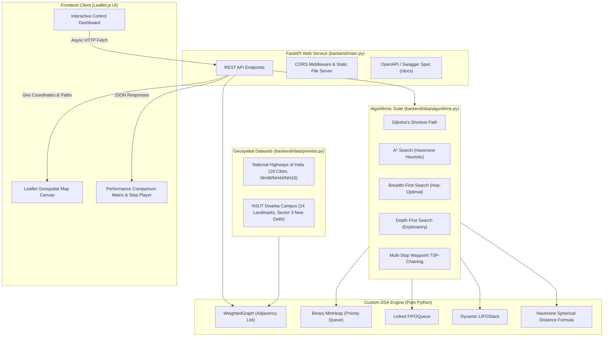

# NavGraph DSA — Full-Stack Map Navigator & Algorithm Visualizer

[](https://fastapi.tiangolo.com/)
[](https://www.python.org/)
[](https://leafletjs.com/)
[](https://docs.pytest.org/)

An academic map navigation engine and data structure visualizer built from first principles in pure Python (zero external DSA dependencies) and served via FastAPI with an interactive Leaflet.js frontend.

---

## Table of Contents
1. [Academic Lab Mapping (Experiments 14 & 15)](#academic-lab-mapping)
2. [Project Architecture](#project-architecture)
3. [Core Data Structures Implemented from Scratch](#core-data-structures-implemented-from-scratch)
4. [Pathfinding Algorithms & Theoretical Comparison](#pathfinding-algorithms--theoretical-comparison)
5. [REST API Reference](#rest-api-reference)
6. [Preset Datasets](#preset-datasets)
7. [Installation & Execution Guide](#installation--execution-guide)
8. [Automated Verification & Test Suite](#automated-verification--test-suite)
9. [Viva-Voce & Lab Evaluation Q&A](#viva-voce--lab-evaluation-qa)
10. [Team](#team)

---

## Academic Lab Mapping

This project fulfills and unifies the requirements for academic Data Structures & Algorithms Lab Experiments:

### Experiment 14: Create a Map Navigator Application; Deploy API for Minor Project
- **Objective**: Design, implement, and deploy a full-featured Map Navigator backend from fundamental computer science data structures.
- **Key Deliverables**:
  - Custom object-oriented Graph model (`WeightedGraph`) maintaining geo-coordinates (latitude/longitude), distances, speed limits, and dynamic traffic multipliers.
  - Priority Queue implemented via custom Array-based Binary Min-Heap (`MinHeap`) for Dijkstra's and A* pathfinding.
  - RESTful API layer built with FastAPI featuring OpenAPI/Swagger documentation (`/docs`).
  - Production-ready packaging for local deployment and containerization (Docker, Render, or Railway).

### Experiment 15: Integrate Backend with Frontend Using API for Minor Project
- **Objective**: Bridge the custom algorithmic engine with a high-performance, responsive map visualization interface.
- **Key Deliverables**:
  - Asynchronous HTTP communication using the modern Fetch API (`async`/`await`).
  - Real-time geospatial rendering via Leaflet.js with custom OpenStreetMap cartography.
  - Visual Step-by-Step Algorithm Replay: Animates Min-Heap exploration frontiers (visited nodes) before rendering the final reconstructed optimal trajectory.
  - Interactive Graph Mutation: Interactive addition of custom waypoints, road closures (blocking edges), and real-time traffic stress simulation.

---

## Project Architecture

### System Flowchart



### Directory Structure

```text
navgraph/
├── backend/
│   ├── data/
│   │   └── presets.py             # India Highways (18 cities) & NSUT Dwarka campus graph
│   ├── dsa/
│   │   ├── algorithms.py          # Dijkstra, A*, BFS, DFS, and comparison benchmarks
│   │   ├── graph.py               # WeightedGraph, Node, Edge, and Haversine formula
│   │   └── structures.py          # Array-backed MinHeap, Linked FIFOQueue, LIFOStack
│   └── main.py                    # FastAPI server, REST routes & static asset serving
├── api/
│   └── index.py                   # Vercel serverless entrypoint
├── public/
│   ├── css/
│   │   └── style.css              # Dark-matte cartography stylesheet & design tokens
│   ├── js/
│   │   └── app.js                 # Leaflet map engine, CARTO dark basemap, DSA player
│   └── index.html                 # Single-page interface & drawer dashboards
├── tests/
│   ├── test_api.py                # FastAPI endpoint integration test suite
│   ├── test_dsa_and_api.py        # Core DSA structure & optimality test suite
│   ├── test_frontend_contract.py  # End-to-end API-frontend contract verification
│   └── test_sessions_and_fixes.py # Sessions, input validation & algorithm regressions
├── Dockerfile                     # Production containerization
├── requirements.txt               # Runtime dependencies
├── requirements-dev.txt           # Test dependencies (pytest, httpx)
├── run_project.py                 # Single-command launcher
└── README.md                      # Comprehensive system documentation
```

---

## Core Data Structures Implemented from Scratch

All data structures are implemented strictly in pure Python standard library types without external algorithmic packages (no `networkx`, no `heapq`).

### 1. Binary Min-Heap Priority Queue (`MinHeap`)
* **File**: `backend/dsa/structures.py`
* **Theory**: A complete binary tree stored compactly as an array/list. For any node at 0-based index $i$:
  - Left Child: $2i + 1$
  - Right Child: $2i + 2$
  - Parent: $\lfloor \frac{i - 1}{2} \rfloor$
* **Operations**:
  - `push(priority, item)`: Appends to list and executes `_sift_up()` in $O(\log N)$ time.
  - `pop()`: Swaps root with leaf, shrinks list, and executes `_sift_down()` in $O(\log N)$ time.
  - `peek()`: Returns root $(priority, item)$ in $O(1)$ time.
  - `is_empty()` / `len()`: Immediate evaluation in $O(1)$ time.
  - Handles duplicate priorities deterministically via monotonic insertion counters.

### 2. Linked FIFO Queue (`FIFOQueue`)
* **File**: `backend/dsa/structures.py`
* **Theory**: Doubly-linked or singly-linked list with dedicated `head` and `tail` pointers.
* **Operations**:
  - `enqueue(item)`: Inserts at tail in $O(1)$ time.
  - `dequeue()`: Removes and returns from head in $O(1)$ time (guaranteeing First-In, First-Out order for unweighted BFS traversal).

### 3. Dynamic LIFO Stack (`LIFOStack`)
* **File**: `backend/dsa/structures.py`
* **Theory**: Dynamic array with top-of-stack pointer.
* **Operations**:
  - `push(item)`: Appends to top in amortized $O(1)$ time.
  - `pop()`: Removes from top in $O(1)$ time (used for DFS traversal and path reconstruction backtracking).
  - `peek()`: Inspects top item without mutation in $O(1)$ time.

### 4. Geospatial Weighted Graph (`WeightedGraph`)
* **File**: `backend/dsa/graph.py`
* **Theory**: Adjacency list representation storing vertices (nodes) and directed/undirected edges.
* **Features**:
  - **Node**: `{id, label, lat, lon}`.
  - **Edge**: `{u, v, distance, speed_limit, traffic_multiplier, is_blocked, one_way}`.
  - **Haversine Distance**: Automatically computes true great-circle spherical distance (in kilometers) between two coordinates using:
    $$d = 2R \arcsin \left( \sqrt{\sin^2\left(\frac{\Delta \phi}{2}\right) + \cos(\phi_1)\cos(\phi_2)\sin^2\left(\frac{\Delta \lambda}{2}\right)} \right)$$
    where $R = 6371.0\text{ km}$.
  - **Dynamic Traffic & Roadblocks**: Edge weights adapt dynamically based on routing mode:
    - Distance Mode: $\text{weight} = \text{distance} \times \text{traffic\_multiplier}$
    - Time Mode: $\text{weight} = \left(\frac{\text{distance}}{\text{speed\_limit}}\right) \times \text{traffic\_multiplier} \times 60 \text{ (minutes)}$
    - Blocked Roads: Treated as infinite weight ($\infty$) or skipped entirely during neighbor traversal.

---

## Pathfinding Algorithms & Theoretical Comparison

| Algorithm | Time Complexity | Space Complexity | Optimality Guarantee | Completeness | Heuristic Driven? | Primary Real-World Application |
| :--- | :---: | :---: | :---: | :---: | :---: | :--- |
| **Dijkstra's Algorithm** | $O((V + E) \log V)$ | $O(V)$ | **Guaranteed Optimal** (Non-negative weights) | Complete | No (Uniform cost search) | Standard GPS navigation, OSPF/IS-IS network routing. |
| **A\* Search** | $O(E)$ (best) to $O((V + E) \log V)$ | $O(V)$ | **Guaranteed Optimal** (with admissible heuristic) | Complete | **Yes** (Haversine spherical distance) | Real-time map route engines (Google Maps, Waze), Robotics motion planning. |
| **Breadth-First Search (BFS)** | $O(V + E)$ | $O(V)$ | **Optimal for Min Hops only** (Unweighted) | Complete | No | Hop-count routing, airline connection minimizer, social network degrees. |
| **Depth-First Search (DFS)** | $O(V + E)$ | $O(V)$ | **Not Optimal** | Complete (Finite graphs) | No | Cycle detection, topological sorting, maze generation, reachability audits. |

### Why A\* Explores Fewer Nodes than Dijkstra:
Dijkstra evaluates nodes uniformly in concentric wavefront circles ($f(n) = g(n)$). In contrast, A\* guides the Min-Heap priority search towards the destination using the evaluation function:
$$f(n) = g(n) + h(n)$$
where $g(n)$ is the exact cost incurred from the start node to $n$, and $h(n)$ is the estimated Haversine straight-line distance from $n$ to the destination. Because the straight-line distance is always $\le$ actual road distance, $h(n)$ is **strictly admissible and consistent**, focusing exploration along an elliptical beam toward the destination.

---

## REST API Reference

The backend serves an automated interactive Swagger UI at `http://localhost:8000/docs` and Redoc at `http://localhost:8000/redoc`.

| Method | Endpoint | Payload / Parameters | Response Description |
| :--- | :--- | :--- | :--- |
| `GET` | `/api/health` | None | Service status, engine version, and active graph summary. |
| `GET` | `/api/presets` | None | Metadata of all available preset maps (`india_highways`, `campus_navigator`). |
| `POST` | `/api/presets/{preset_id}/load` | Path: `preset_id` (`india_highways` / `campus_navigator`) | Loads the preset into the caller's graph. |
| `POST` | `/api/session/restore` | JSON: `{preset, nodes, adjacency_list}` + `X-Session-Id` header | Rebuilds a session graph from a client snapshot. |
| `GET` | `/api/graph` | Query: `preset?` | Complete topology: nodes, edges, adjacency list, traffic factors, and stats. |
| `POST` | `/api/route` | JSON: `{source, target, waypoints?, algorithm, weight_mode}` | Path, distance, travel time, nodes explored, and animation steps. |
| `POST` | `/api/multi-stop` | JSON: `{waypoints, algorithm, weight_mode}` | Stitched multi-leg itinerary. |
| `POST` | `/api/compare` | JSON: `{source, target, weight_mode}` | Runs Dijkstra, A\*, BFS, and DFS and returns a comparison table. |
| `POST` | `/api/node` | JSON: `{id?, name, lat, lng, category?, description?}` | Adds a node (ID generated from the name if omitted). |
| `DELETE` | `/api/node/{node_id}` | Path: `node_id` | Deletes a node and removes all incident edges. |
| `POST` | `/api/edge` | JSON: `{source, target, base_distance_km?, road_name?, traffic_multiplier?, is_blocked?, speed_limit_kmh?, bidirectional?}` | Adds an edge (Haversine x 1.15 if distance omitted). |
| `DELETE` | `/api/edge` | Query: `source`, `target`, `bidirectional?` | Removes an edge. |
| `PATCH` | `/api/edge/traffic` | JSON: `{source, target, traffic_multiplier?, is_blocked?, bidirectional?}` | Updates congestion factor or closes a road. |
| `POST` | `/api/graph/simulate-traffic` | JSON: `{congestion_probability?, block_probability?, reset?}` | Randomized congestion and up to 3 road closures. |
| `POST` | `/api/graph/reset-traffic` | None | Restores all multipliers to `1.0` and clears roadblocks. |

### Sessions & Limits
- The web UI sends an `X-Session-Id` header so every browser tab gets its own private graph; edits never affect other visitors.
- Requests without the header (Swagger UI, curl) share one default graph.
- On serverless hosts a request may reach an instance that has never seen the session. The API then answers `409` with `code: "session_expired"`, and the UI re-uploads its graph via `/api/session/restore` and retries automatically.
- Input limits: latitude -90..90, longitude -180..180, node IDs `[A-Za-z0-9_-]{1,64}`, at most 200 nodes and 4000 directed edges per graph, traffic multiplier 1.0..10.0. Road lengths shorter than the straight-line distance are rejected so the A\* heuristic stays admissible.

---

## Preset Datasets

### 1. National Highways of India (`india_highways`)
- **18 Major Metro & Transit Hubs**: New Delhi, Chandigarh, Jaipur, Lucknow, Ahmedabad, Bhopal, Patna, Guwahati, Kolkata, Mumbai, Pune, Nagpur, Bhubaneswar, Hyderabad, Visakhapatnam, Bengaluru, Chennai, Kochi.
- **Real-world Corridors**: Modeled after the Golden Quadrilateral and major National Highways (NH48, NH44, NH19, NH16) with approximate road distances, real city coordinates, and highway speed limits (70–110 km/h).

### 2. NSUT Dwarka Campus (`campus_navigator`)
- **14 Campus Landmarks (Sector 3, Dwarka, New Delhi)**: NSUT Main Gate (Azad Hind Fauj Marg), Nescii Lawns & Netaji Statue, Administrative Block (VC Office), Central Library & SAC, Block 5 (CSE & IT Dept), Block 4 (ECE & Biotech Dept), Block 6 & Connecting Block (ICE/EE), APJ Abdul Kalam Lecture Complex, Students' Centre (Amul & Canteen), Boys Hostels, Girls Hostels, NSUT Sports Complex, Moksha Ground & Medical Centre, NSUT North Gate.
- **Internal Walkways & Campus Avenues**: Modeled with internal campus speed limits (15–20 km/h) and approximate GPS coordinates.

---

## Installation & Execution Guide

### Prerequisites
- Python 3.10 or higher
- Modern web browser (Chrome, Firefox, Edge, Safari)

### Step 1: Clone or Navigate to Project Directory
```powershell
cd navgraph
```

### Step 2: Install Required Dependencies
```powershell
pip install -r requirements-dev.txt
```

### Step 3: Launch the Full-Stack Application
Execute the unified one-click launcher:
```powershell
python run_project.py
```
Or start FastAPI via Uvicorn directly:
```powershell
uvicorn backend.main:app --host 127.0.0.1 --port 8000 --reload
```

### Step 4: Access the Application
- **Interactive Map Navigator UI**: [http://localhost:8000](http://localhost:8000)
- **Interactive Swagger Documentation**: [http://localhost:8000/docs](http://localhost:8000/docs)
- **Alternative Redoc Documentation**: [http://localhost:8000/redoc](http://localhost:8000/redoc)

---

## Automated Verification & Test Suite

The project includes an exhaustive automated test suite covering all data structures, pathfinding algorithms, geospatial formulas, dynamic rerouting, and API endpoints.

Execute the test suite with `pytest`:
```powershell
pytest -v
```

### What the Test Suite Verifies:
1. **MinHeap Verification**: Push/pop ordering, duplicate priorities, heap property maintenance, peek, empty queue exceptions.
2. **FIFOQueue & LIFOStack**: FIFO order validation, LIFO order validation, boundary conditions.
3. **Graph Operations**: Dynamic node/edge addition and deletion, Haversine distance accuracy, traffic scaling, edge blocking.
4. **Optimality Check**: Verifies that Dijkstra and A\* yield identical optimal distances on real road networks.
5. **Heuristic Pruning Check**: Verifies that A\* explores $\le$ nodes than Dijkstra (`nodes_explored_astar <= nodes_explored_dijkstra`).
6. **Dynamic Rerouting**: Tests that blocking a road on the primary path forces the algorithms to identify valid detours.
7. **FastAPI Endpoints**: Validates health, preset loading, route computation, algorithm comparison, and CRUD endpoints.

---

## Team

| Name | Roll Number |
| :--- | :--- |
| Revanshu Ranjan | 2025UEE4570 |
| Keshav Gupta | 2025UEE4564 |
| Jatin | 2025UEE4560 |
| Aryan Jain | 2025UEE4565 |
| Sneha Baghel | 2025UEE4571 |

---

## Contributors & Academic Credits
- **Course**: Data Structures & Algorithms Lab (EEITC302)
- **Experiments**: Experiment 14 (Map Navigator API Backend) & Experiment 15 (Full-Stack Frontend Integration)
- **Implementation**: Pure Python DSA Engine & Modern Web Integration
